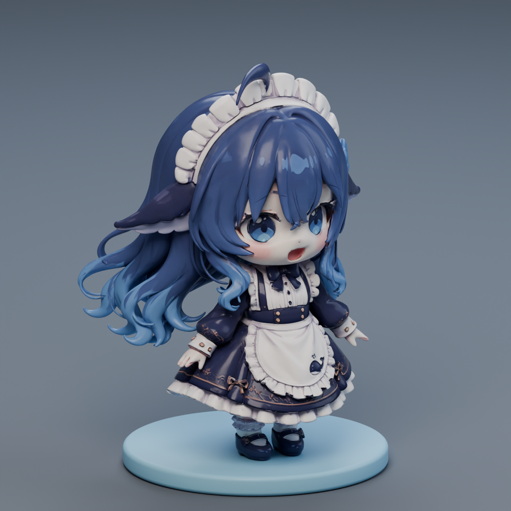

# DeepSeek 鲸鱼娘 Q 版 3D 模型

基于 DeepSeek 鲸鱼娘的 Q 版蓝白短女仆三视图，使用 Kimi 3D Make 辅助生成的同人三维模型。本项目用于个人学习、模型展示及后续可动角色制作研究，**并非 DeepSeek 官方形象或官方模型**。

## 当前内容与技术路线

仓库包含原始 GLB、模型预览、过程图和三视图参考。当前 GLB 为静态网格，包含角色与底座，尚无骨骼或动画。

后续计划：

1. 保留原始 GLB，在 Blender 中清理、拆分并减面。
2. 完成人体骨骼绑定与蒙皮，为长发、裙摆和鲸尾添加辅助骨骼。
3. 制作眨眼、呼吸和尾巴摆动等待机动作，再逐步扩展动画。
4. 根据展示、动画或游戏等用途导出相应格式。

## 许可说明

本仓库中的模型作为第三方角色的同人衍生作品，遵循 [CC BY-NC-SA 4.0](https://creativecommons.org/licenses/by-nc-sa/4.0/deed.zh-hans) 进行非商业分享。

使用或再创作时须保留署名与来源、标明所作修改，并以相同许可分享衍生作品。**不得将模型、衍生作品或打印成品用于销售等商业用途。** DeepSeek 名称及相关品牌权利归相应权利人所有。

第三方参考素材的权利归各自创作者所有，本仓库不对其另行授权。若来源或许可信息有误，欢迎通过 Issue 提供可核实的出处。

## 形象参考与致谢

- **上善无形**：原始鲸鱼娘角色创作者，[Bilibili 主页](https://space.bilibili.com/4456176)。
- **ZipZipPipe**：基于原角色进行 DeepSeek 女仆二次设计；[相关作品与许可说明](https://www.bilibili.com/video/BV1tE9XBbErS/)。
- **梗鲸设定集**：本项目所用 Q 版三视图的[整理来源](https://aigengtu.com/refs)；具体绘制者目前仍待核实。
- **ai-girls 素材档案**：提供[来源与创作链核验记录](https://github.com/shuaizenge/ai-girls/tree/main/characters/deepseek)。
- **Kimi 3D Make**：模型生成工具。

感谢上述创作者、整理者与工具提供方。
